<p align="center">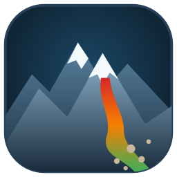</p>

<h1 align="center">DFCC — Debris-Flow Channel Classification</h1>

<p align="center">
<b>Where can a debris flow start, how far can it travel, and where does it stop?</b><br>
A free, stand-alone implementation of the <i>Procedura DF</i> — GUI · command line · QGIS plugin · ArcGIS Pro toolbox · pip package · Windows executable.
</p>

<p align="center">
<a href="LICENSE"></a>


</p>

<p align="center">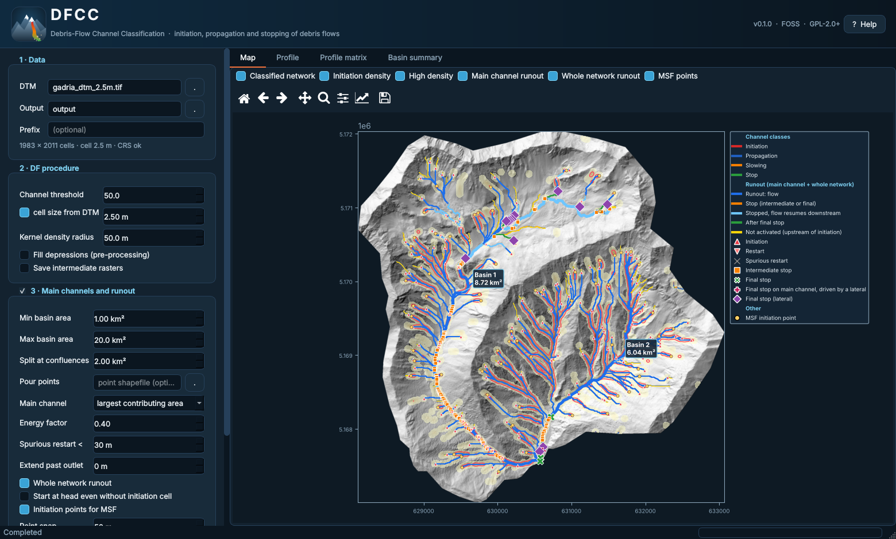</p>

> **Status — v0.4.0 (testing).** The numerical core is verified against the original ArcGIS/TauDEM workflow (see [Validation](#validation));
> the GUI, the plugins and the runout extensions are young. Bug reports and test cases are very welcome (see [Contact](#authors-and-contact)).

<a name="dtm-resolution-and-the-default-thresholds"></a>
> [!IMPORTANT]
> **DTM resolution and the default thresholds — please read.**
> The default thresholds of Procedura DF (initiation curve `S > 0.32·A^-0.2`, slope classes at 8° and 3°, 38° upper limit) come from
> literature based on DTMs of about **10 m** resolution, **not LiDAR** (Horton et al. 2013 consider a 10 m DEM "a good compromise between
> processing time and quality of results", following Zhang & Montgomery 1994 and Quinn et al. 1995). The slopes these thresholds refer to —
> above all the non-linear area–slope initiation curve — are **reach-scale** channel slopes, not the very local slope of a boulder, a step
> or a vertical drop. A very high-resolution DTM (e.g. 0.5–2.5 m LiDAR) inevitably resolves such local features and alters slopes,
> classes and the representativeness of the thresholds (Vianello et al. 2009; Kienzle 2004).
> **With fine DTMs, consider generalizing the DTM to 5–10 m** (`--generalize`, GUI *Advanced* tab) and change the thresholds only after a
> calibration on field data. DFCC prints a warning when the cell size is below 5 m. The Gadria example runs at 2.5 m only because it
> reproduces, bit by bit, the original ArcGIS workflow: it is a software check, not a recommended resolution.

## Contents

1. [What DFCC does](#what-dfcc-does)
2. [Installation](#installation)
3. [Quick start](#quick-start)
4. [How it works](#how-it-works) · [Scientific basis of the thresholds](#scientific-basis-of-the-thresholds)
5. [Example results — Gadria test case](#example-results--gadria-test-case)
6. [Outputs](#outputs)
7. [Parameters](#parameters) · [Advanced parameters and DTM generalization](#advanced-parameters-and-dtm-generalization)
8. [Validation](#validation)
9. [The graphical interface and the built-in Help](#the-graphical-interface-and-the-built-in-help)
10. [Repository layout](#repository-layout) · [The `old/` folder](#the-old-folder)
11. [Citation](#citation) · [Authors and contact](#authors-and-contact) · [License](#license)

## What DFCC does

Starting from a **DTM** only, DFCC answers four questions about every debris-flow-prone catchment:

| Step | Question | Result |
|---|---|---|
| 1 · Channel classification | Which parts of the channel network are prone to **initiation**, **propagation**, **slowing** or **stopping** of a debris flow? | `ClassifiedNetwork.tif`, `Network_classes.shp`, `Network3D.shp` |
| 2 · Initiation density | Where do potential initiation points **cluster**? | `InitiationDensity.tif` (points/ha), `HighDensity.shp` (natural breaks) |
| 3 · Runout | Along the main channel of each basin, where does the flow **start, stop, restart** and **stop for good**? | `Runout_mainchannel.shp`, `Runout_events.shp`, `Runout_summary.csv` |
| 4 · MSF input | Which points should seed a debris-flow **runout simulation** (MSF / Flow-R style)? | `InitiationPoints_MSF.shp` |

An optional **whole-network runout** applies the same energy rule to *every* channel of the selected basins (not only the main one), propagating
the locally worst condition at confluences — useful to see which tributaries are able to deliver debris to the main channel.

No ArcGIS, no TauDEM, no MPI: every routine (Fill, D8, D∞, D8 contributing area, slope-area, kernel density, stream-to-feature, interpolate-shape) is
re-implemented in Python/numba and **verified bit-by-bit against the originals**. A 2011 × 1983-cell DTM runs from DTM to vector network and density in about 5 s.

## Installation

**Windows executable (no Python needed)** — download `DFCC-windows.zip` from the [Releases](../../releases) page, unzip and run `DFCC.exe`
(no arguments → graphical interface; with arguments → command line, e.g. `DFCC.exe run dtm.tif -o out --runout`).

**pip** (Python ≥ 3.9):

```bash
pip install "dfcc[gui] @ git+https://github.com/HydrogeomorphologyTools/DFCC"      # GUI + CLI
pip install "dfcc @ git+https://github.com/HydrogeomorphologyTools/DFCC"           # CLI only
```

or from a clone: `pip install -e ".[gui,test]"`.

**QGIS** (≥ 3.22) — copy the folder [`qgis_plugin/dfcc_qgis`](qgis_plugin/dfcc_qgis) into your QGIS plugins directory and enable *DFCC* in the Plugin Manager.
The algorithm appears in the Processing Toolbox. It uses the `dfcc` Python package when available in the QGIS Python, otherwise the stand-alone
executable (set the environment variable `DFCC_EXE` to the path of `DFCC.exe`). Results are loaded with ready-made styles.

**ArcGIS Pro** — add [`arcgis_toolbox/DFCC.pyt`](arcgis_toolbox/DFCC.pyt) to a project (*Catalog → Toolboxes → Add Toolbox*). Same logic: the `dfcc` package if
importable, otherwise `DFCC_EXE`.

## Quick start

```bash
dfcc gui                                       # graphical interface

cd examples/gadria                             # run the bundled test case from a saved configuration
dfcc run --config dfcc_config.json

dfcc run dtm.tif -o out --runout               # your own DTM: procedure + main channels + runout + MSF points
dfcc run dtm.tif -o out --runout --whole-network --extend-downstream 500
dfcc run dtm.tif -o out --runout --pour-points outlets.shp --extend-polygon catchment_and_fan.shp
dfcc run lidar_1m.tif -o out --generalize 10 --generalize-method median   # fine DTM: generalize to 10 m first
dfcc run dtm.tif -o out --s-slow 0.1763 --s-stop 0.0699                    # sensitivity: classes at 10° and 4°
dfcc fill dtm.tif dtm_fill.tif                 # depression filling only (identical to ArcGIS Fill)
```

The DTM must be in a **projected CRS with square cells**. A pit-filled DTM can be used directly; otherwise tick *Fill depressions* (`--prefill`).
The complete parameter set can be saved and reloaded as JSON from the GUI and from the CLI (`--save-config`, `--config`).

## How it works

<p align="center">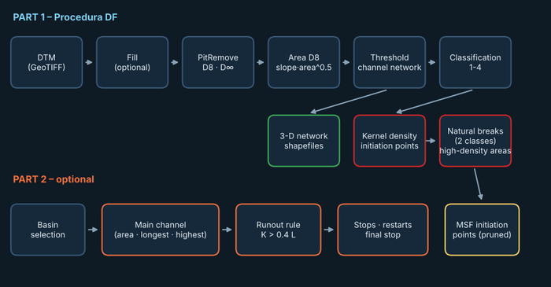</p>

0. *(optional)* **DTM generalization** to a coarser cell size (see [Advanced parameters](#advanced-parameters-and-dtm-generalization)).
1. **Terrain analysis** (TauDEM-equivalent): pit removal, D8 flow directions, D∞ slope, D8 contributing area **A** (in cells), slope-area index `S·A^0.5`, and the channel network from a slope-area threshold.
2. **Channel classes** — every network cell receives one of four classes from its local slope **s** and contributing area **A** (km²):

   | Class | Meaning | Rule |
   |---|---|---|
   | 2 | **Initiation** | `s > WB`, with `WB = 0.32·A^-0.2` and `A < 20 km²` |
   | 1 | **Propagation** | `s ≥ 0.1405` and not an initiation cell |
   | 3 | **Slowing** | `0.0524 < s < 0.1405` |
   | 4 | **Stop zone** | `s < 0.0524` |

3. **Initiation density** — the initiation cells are turned into points and a quartic **kernel density** (radius 50 m, points/ha) is computed; a 2-class **natural-breaks** (Fisher–Jenks) split of the non-zero density defines the high-density areas.
4. **Runout energy rule** — walking downstream along the main channel:
   `L` = cumulated elevation drop on class 1–2 cells; `K` = cumulated distance on class 3–4 cells.
   The flow **stops** at the first cell where `K > 0.4·L`, **restarts** at the next initiation cell (L and K reset), and a restart that dies within 30 m is *spurious*.
   The **final stop** is the last stop with no valid restart downstream.

   <p align="center">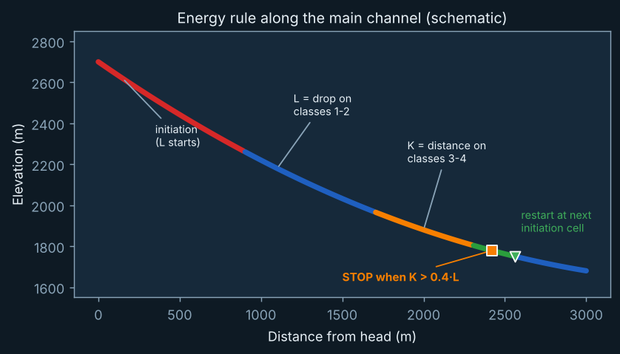</p>

5. **Whole-network mode (optional)** — the same rule on every channel cell, processed upstream → downstream. Where flowing branches merge, the one with the **largest energy margin** `0.4·L − K` is propagated (an envelope — states are never summed). A flowing tributary can re-activate a stopped trunk. The main-channel results do not change.

More detail in [`docs/METHOD.md`](docs/METHOD.md) and in the built-in Help.

## Scientific basis of the thresholds

DFCC reproduces the empirical, purely morphometric procedure of Cavalli et al. (2017); the thresholds are not tuned by the software but inherited from the literature below (section 1.1 of the paper). They can be re-parametrised for other settings, but the defaults replicate the original ArcGIS workflow bit by bit.

**Channel network - slope-area threshold.** Channels are the cells exceeding a threshold of the Stream Power Index `SPI = A^0.5 · S` (Marchi & Dalla Fontana 2005), computed on D8 flow directions (O'Callaghan & Mark 1984). As in the original TauDEM workflow (`AreaD8 -nc`, `SlopeArea`, `D8FlowPathExtremeUp`), **A is the D8 contributing area counted in cells** and S the D8 slope (m/m), so the threshold value depends on the cell size (see [Advanced parameters](#advanced-parameters-and-dtm-generalization)). Slope-area channel-initiation thresholds follow Montgomery & Dietrich (1992), Montgomery & Foufoula-Georgiou (1993) and Desmet et al. (1999). The threshold value (`-t`, default 50) must be calibrated on field observations and on the drainage density of the area. Local slope is the drop to the steepest-descent neighbour (Vianello et al. 2009).

**Debris-flow initiation - area-slope threshold.** A network cell is a potential initiation point when its slope exceeds

```
S = 0.32 · A^-0.2        (A = contributing area in km², S = local D∞ slope in m/m)
```

the empirical envelope derived by Zimmermann et al. (1997) from debris-flow events in Switzerland, in the spirit of the models of Wichmann & Becht (2005) and Horton et al. (2013).
The same curve is Eq. 1 of Horton et al. (2013) — `tan β = 0.32 · S_uca^-0.2`, S_uca in km², the lower limit for "rare" events in the central Alps,
after Rickenmann & Zimmermann (1993) and Heinimann (1998) — which Horton et al. apply for S_uca < 2.5 km² and recommend using with a ~10 m DEM.
The classification slope is the D∞ slope (Tarboton 1997). Kaless (2006) verified it against initiation areas in the Autonomous Province of Trento (eastern Italian Alps). Two filters complete the rule: an upper local slope of **38°** (about the internal friction angle of alpine debris), which removes very steep bedrock-like cells where sediment is scarce, and an upper drainage-area limit above which channels are dominated by bedload and suspended transport (**10 km²** in the paper, after Marchi & D'Agostino 2004; the original ArcGIS model, and therefore DFCC's default, uses **20 km²**).

**Propagation, slowing and stop - slope classes.** Debris flows start depositing on slopes of roughly 6°-10° and usually stop at about 3°-5° (Benda 1985; Vandre 1985; Burton & Bathurst 1998). Following a cautionary approach, the remaining network cells are classified as

| Local slope | Class |
|---|---|
| > 8° (tan = 0.1405) and not initiation | 1 - Propagation |
| 3° - 8° | 3 - Slowing (deceleration) |
| < 3° (tan = 0.0524) | 4 - Stop |

**Runout - energy rule.** The runout distance follows the empirical relation of Vandre (1985), `W = α · Δh` with `α = 0.4`, and the rule-based transport model of Burton & Bathurst (1998). Differently from the original thresholds (flow continues above 10°, stops between 4° and 10° or at 4°), DFCC uses the 8° and 3° limits above: the flow halts when `distance on slopes < 8°  >  0.4 · elevation lost on slopes > 8°`, and may restart at a downstream initiation cell.

**Initiation density.** Initiation points are turned into a kernel-density map (50 m radius, points/ha) and split in two classes with natural breaks, to rank the most hazardous reaches (Cavalli et al. 2017).

**Resolution.** These thresholds were developed with DTMs of about 10 m (Horton et al. 2013; Zhang & Montgomery 1994; Quinn et al. 1995) and describe
reach-scale channel slopes. Slopes computed on very fine LiDAR DTMs are systematically different — steeper on local steps, flatter on the
treads between them (Vianello et al. 2009; Kienzle 2004) — which shifts cells across the 8° / 3° boundaries and across the non-linear
initiation curve. Generalize fine DTMs (5–10 m) or re-calibrate the thresholds.

### References

* Benda, L.E. (1985). Behaviour and effect of debris flows on streams in the Oregon Coast Range. In: *Delineation of landslide, flash flood and debris flow hazards in Utah*, Utah Water Research Laboratory, Logan, 153-162.
* Burton, A., Bathurst, J.C. (1998). Physically based modelling of shallow landslide sediment yield at a catchment scale. *Environmental Geology* 35(2-3), 89-99. <https://doi.org/10.1007/s002540050296>
* Cavalli, M., Crema, S., Trevisani, S., Marchi, L. (2017). GIS tools for preliminary debris-flow assessment at regional scale. *Journal of Mountain Science* 14(12), 2498-2510. <https://doi.org/10.1007/s11629-017-4573-y>
* Desmet, P.J.J., Poesen, J., Govers, G., Vandaele, K. (1999). Importance of slope gradient and contributing area for optimal prediction of the initiation and trajectory of ephemeral gullies. *Catena* 37(3-4), 377-392. <https://doi.org/10.1016/S0341-8162(99)00027-2>
* Heinimann, H.R. (1998). *Methoden zur Analyse und Bewertung von Naturgefahren.* Umwelt-Materialien 85, BUWAL, Bern (in German); cited after Horton et al. (2013).
* Horton, P., Jaboyedoff, M., Rudaz, B., Zimmermann, M. (2013). Flow-R, a model for susceptibility mapping of debris flows and other gravitational hazards at a regional scale. *Natural Hazards and Earth System Sciences* 13(4), 869-885. <https://doi.org/10.5194/nhess-13-869-2013>
* Kaless, G. (2006). *Il torrente Sarca di Val Genova. Studio geomorfologico per la prevenzione e la mitigazione del rischio geo-idrologico.* Master thesis, University of Padova (in Italian).
* Kienzle, S. (2004). The effect of DEM raster resolution on first order, second order and compound terrain derivatives. *Transactions in GIS* 8(1), 83-111. <https://doi.org/10.1111/j.1467-9671.2004.00169.x>
* Marchi, L., D'Agostino, V. (2004). Estimation of debris-flow magnitude in the Eastern Italian Alps. *Earth Surface Processes and Landforms* 29(2), 207-220. <https://doi.org/10.1002/esp.1027>
* Marchi, L., Dalla Fontana, G. (2005). GIS morphometric indicators for the analysis of sediment dynamics in mountain basins. *Environmental Geology* 48(2), 218-228. <https://doi.org/10.1007/s00254-005-1292-4>
* Montgomery, D.R., Dietrich, W.E. (1992). Channel initiation and the problem of landscape scale. *Science* 255(5046), 826-830. <https://doi.org/10.1126/science.255.5046.826>
* Montgomery, D.R., Foufoula-Georgiou, E. (1993). Channel network source representation using digital elevation models. *Water Resources Research* 29(12), 3925-3934. <https://doi.org/10.1029/93WR02463>
* O'Callaghan, J.F., Mark, D.M. (1984). The extraction of drainage networks from digital elevation data. *Computer Vision, Graphics, and Image Processing* 28(3), 323-344. <https://doi.org/10.1016/S0734-189X(84)80011-0>
* Quinn, P.F., Beven, K.J., Lamb, R. (1995). The ln(a/tan β) index: how to calculate it and how to use it within the TOPMODEL framework. *Hydrological Processes* 9(2), 161-182. <https://doi.org/10.1002/hyp.3360090204>
* Rickenmann, D., Zimmermann, M. (1993). The 1987 debris flows in Switzerland: documentation and analysis. *Geomorphology* 8(2-3), 175-189. <https://doi.org/10.1016/0169-555X(93)90036-2>
* Tarboton, D.G. (1997). A new method for the determination of flow directions and upslope areas in grid digital elevation models. *Water Resources Research* 33(2), 309-319. <https://doi.org/10.1029/96WR03137>
* Vandre, B.C. (1985). Rudd Creek debris flow. In: *Delineation of landslide, flash flood and debris flow hazards in Utah*, Utah Water Research Laboratory, Logan, 117-131.
* Vianello, A., Cavalli, M., Tarolli, P. (2009). LiDAR-derived slopes for headwater channel network analysis. *Catena* 76(2), 97-106. <https://doi.org/10.1016/j.catena.2008.09.012>
* Wichmann, V., Becht, M. (2005). Modelling of geomorphic processes in an alpine catchment. In: Atkinson, P.M., et al. (eds), *GeoDynamics*, 151-167.
* Zhang, W., Montgomery, D.R. (1994). Digital elevation model grid size, landscape representation, and hydrologic simulations. *Water Resources Research* 30(4), 1019-1028. <https://doi.org/10.1029/93WR03553>
* Zimmermann, M., Mani, P., Gamma, P., et al. (1997). *Murganggefahr und Klimaaenderung - ein GIS-basierter Ansatz.* Schlussbericht NFP 31, Zurich (in German).


## Example results — Gadria test case

The folder [`examples/gadria`](examples/gadria) contains the 2.5 m DTM of the Gadria catchment (Eastern Alps, UTM 32N), the saved configuration, and the original
ArcGIS/TauDEM outputs used for the validation. All figures below are produced by [`docs/make_figures.py`](docs/make_figures.py) with
`examples/gadria/dfcc_config.json` (threshold 50, kernel radius 50 m, basins 1–20 km², energy factor 0.4, whole-network on).

### 1 · Classified channel network

<p align="center">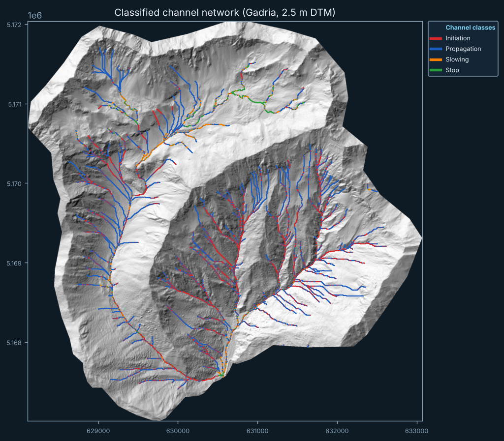</p>

The 402 channel arcs (82.2 km) are split into **initiation** (red, 7,975 cells), **propagation** (blue, 17,196), **slowing** (orange, 1,772) and **stop** (green, 974 cells).
Initiation cells sit on the steep upper tributaries of both basins; the stop and slowing classes concentrate where the main trunks flatten out
towards the valley floor. This layer is the input of everything that follows and is identical, pixel for pixel, to the ArcGIS/TauDEM result.

### 2 · Initiation density and high-density areas

<p align="center">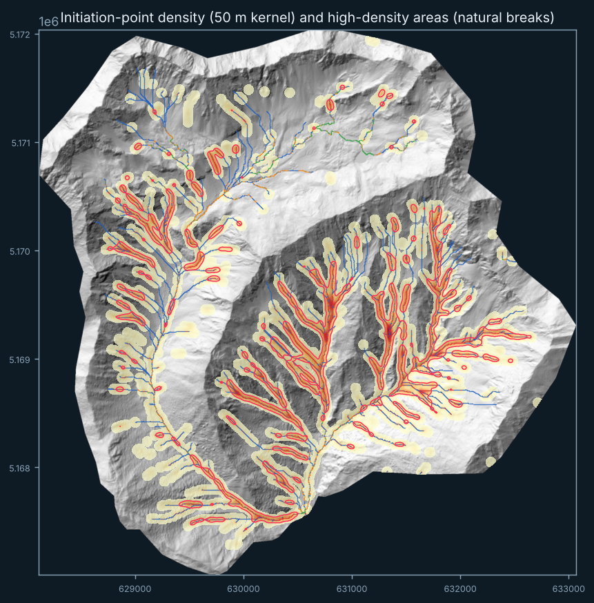</p>

8,571 potential initiation points produce a kernel-density surface with a maximum of 153 points/ha. The natural break between "low" and "high" density falls at
27.1 points/ha and delimits 107 high-density polygons (red outlines): the sectors of the slopes where debris flows are most likely to start. They are
spread over the headwater gullies of both basins.

### 3 · Main channel runout

<p align="center">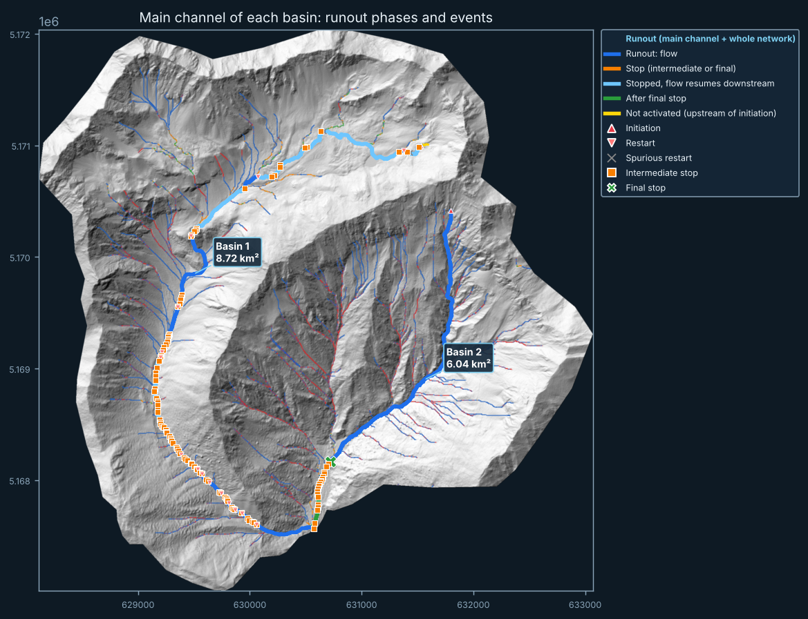</p>

The two basins found automatically (**Basin 1**, 8.72 km²; **Basin 2**, 6.04 km²) are followed along their main channel (largest contributing area at each confluence).
Colours show the *phase* of the flow along the channel: <span style="color:#ffd60a">yellow</span> not yet activated, <span style="color:#1f6feb">blue</span> flowing,
<span style="color:#f77f00">orange</span> stop, <span style="color:#6ec6ff">light blue</span> stopped but the flow resumes downstream, <span style="color:#2a9d3c">green</span> after the final stop.
Basin 1 (7,064 m long) alternates many short stops with restarts on its lower reach (90 stops, 15 valid restarts, 75 spurious ones) but the flow **reaches the outlet**.
Basin 2 (3,724 m) has a **final stop** at 3,035 m from the head (z = 1,489 m), 689 m before the outlet: in this model, debris flows of that channel do not reach the confluence.

### 4 · Longitudinal profile with events

<p align="center">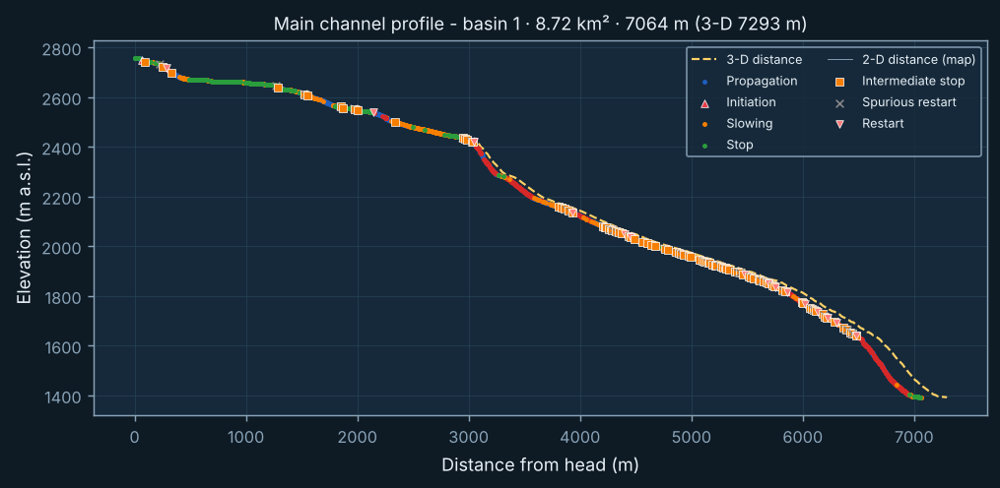<br>
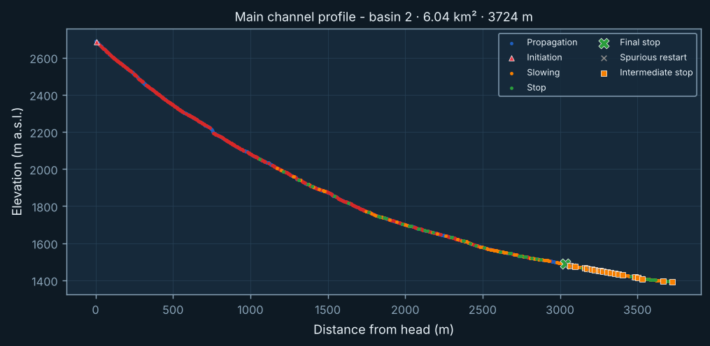</p>

The profile of each main channel is coloured by class and carries the runout events (initiation ▲, intermediate stop ■, restart ▼, final stop ✖). The dashed line in
the first plot is the same profile against the **3-D distance** (7,293 m instead of 7,064 m for Basin 1). In Basin 2 the distance travelled on slowing and stop cells
exceeds `0.4·L` at 3,035 m from the head, which produces the final stop (green ✖).

### 5 · Whole-network runout

<p align="center">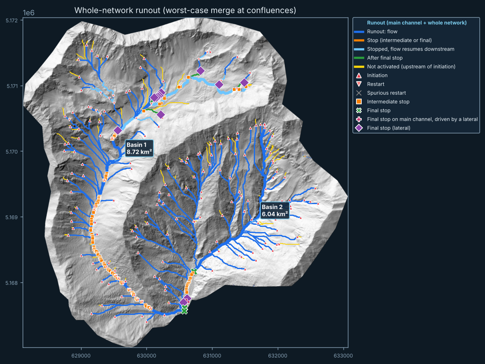</p>

With the optional whole-network mode every tributary is evaluated. In Basin 1, 9,781 of the 13,528 channel cells (24.5 km) are in flow and the network
outlet is reached by the flow; in Basin 2, 12,532 of 14,292 cells (31.3 km) flow but the outlet is in a stopped state (margin −1.7 m).
<span style="color:#8e44ad">◆ Purple diamonds</span> are **final stops on laterals** (Basin 1: 10; Basin 2: 3) — expected and harmless for the main channel;
a <span style="color:#c2185b">✚ magenta plus</span> would flag a final stop on the main channel caused by the energy of a lateral (none in this example). Thin yellow
tracts are channels upstream of any initiation cell. The thick main-channel layer is drawn underneath so that both results can be compared.

### 6 · Initiation points for MSF

<p align="center">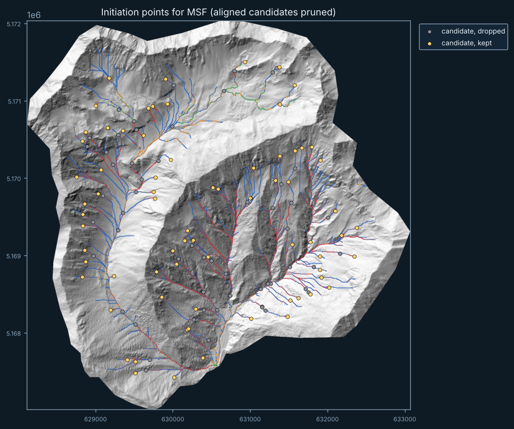</p>

One candidate point is placed at the head of each high-density area, snapped to the network (50 m) and pruned when it lies downstream of a higher aligned
candidate: 131 candidates, **73 kept** (yellow) and 58 dropped (grey). The kept points are written to `InitiationPoints_MSF.shp` and can seed an MSF/Flow-R runout simulation directly.

### 7 · Profile matrix

<p align="center">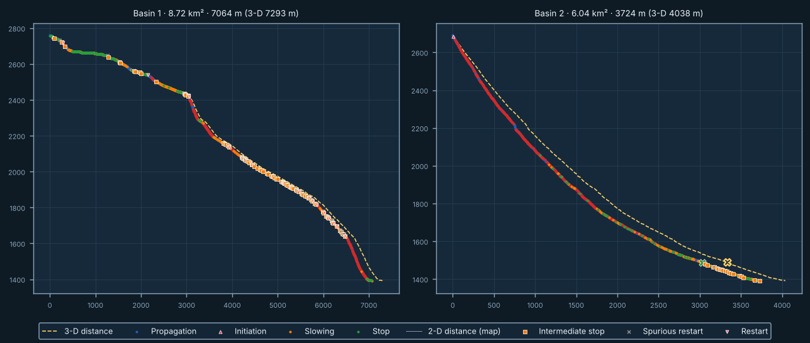</p>

All basins side by side (titles give basin number, area, 2-D and 3-D length): handy to compare the energy balance of many catchments at a glance.

## Outputs

| File | Content |
|---|---|
| `ClassifiedNetwork.tif` | 1 propagation · 2 initiation · 3 slowing · 4 stop |
| `InitiationDensity.tif` | Kernel density of initiation points (points/ha) |
| `HighDensity.tif` / `.shp` | High-density areas (2-class natural breaks of the non-zero density) |
| `Network3D.shp`, `Network_classes.shp` | Network with elevation; network split by class (ready to style) |
| `Runout_mainchannel.shp` | Main channel tracts with `class`, `df_yn` and **`phase`** (1 not activated · 2 flow · 3 stop · 4 stopped but flow resumes · 5 after final stop) |
| `Runout_events.shp` | Initiation, intermediate stops, restarts, spurious restarts, **final stop** |
| `Runout_points.shp` | Point profile (`DF_YN`, `L_drop`, `K_dist`, cumulated distance) |
| `Runout_summary.csv` | One row per basin: area, 2-D/3-D length, stops, restarts, final-stop position and distance to the outlet, `net_*` columns in whole-network mode |
| `Runout_network.shp`, `Runout_network_events.shp` | *(whole-network mode)* all channels with `phase`, `main` flag, L, K, margin; events with lateral final stops |
| `InitiationPoints_MSF.shp`, `…_candidates.shp` | Seed points for MSF runout simulations, before and after pruning |

## Parameters

| Option (CLI) | Default | Meaning |
|---|---|---|
| `-t, --threshold` | 50 | Slope-area threshold defining the channel network |
| `--prefill` | off | Fill depressions before the analysis (ArcGIS-identical) |
| `--kd-radius` | 50 m | Kernel-density radius |
| `--min-area / --max-area / --split-area` | 1 / 20 / 2 km² | Basin selection: outlets between min and max area, split at confluences whose two branches both exceed *split* |
| `--pour-points` | – | Shapefile of pour points (overrides the automatic selection) |
| `--main-branch` | `area` | Main channel: `area` (largest contributing area at each confluence), `longest` or `highest` |
| `--energy-factor` | 0.4 | The flow stops when `K > factor · L` |
| `--min-restart-len` | 30 m | Restarts dying within this length are *spurious* |
| `--extend-downstream`, `--extend-polygon` | off | Continue the profile below the outlet (e.g. over a fan), for a distance or until a polygon is left |
| `--whole-network` | off | Apply the energy rule to every channel of the selected basins |
| `--no-hotspots`, `--hotspot-snap`, `--no-prune` | – | MSF initiation points options |
| `--generalize`, `--slope-exp`, `--s-slow`, … | – | See [Advanced parameters and DTM generalization](#advanced-parameters-and-dtm-generalization) |

`dfcc run --help` lists everything.

## Advanced parameters and DTM generalization

The defaults reproduce the original Procedura DF and the validation below. For sensitivity analyses or calibrated applications in other
settings, every threshold can be changed — in the GUI (**Advanced** tab, next to *Parameters*), on the command line, in the JSON
configuration and in the QGIS / ArcGIS tools (group *Advanced parameters*). Read the [resolution note](#dtm-resolution-and-the-default-thresholds) first.

| Setting | CLI | Default | Meaning |
|---|---|---|---|
| Generalization cell size | `--generalize CELL` | off | Pre-processing: aggregate the DTM to a coarser cell size; fill, flow directions and the whole procedure then run on the generalized DTM (`DTM_generalized.tif` is written) |
| Generalization method | `--generalize-method` | `average` | `average` (area-weighted mean of the input cells, recommended), `median` (median of the cells centred in the new cell: robust to spikes, boulders, artefacts) — both computed by DFCC itself; `bilinear`, `cubic` (GDAL interpolation) |
| Keep threshold | `--generalize-keep-threshold` | off | By default the channel threshold is rescaled by `(old cell / new cell)^(2n)` (see below) |
| Slope exponent *m* | `--slope-exp` | 1 | Channel extraction on `S^m · A^n` |
| Area exponent *n* | `--area-exp` | 0.5 | Channel extraction on `S^m · A^n` |
| Initiation coefficient *k* | `--wb-k` | 0.32 | Initiation where `S > k · A^e` (A in km²) |
| Initiation exponent *e* | `--wb-exp` | −0.2 | idem |
| Max initiation area | `--max-init-area` | 20 km² | No initiation where A ≥ this value |
| Propagation / slowing | `--s-slow` | 0.1405 (8°) | Slope boundary between classes 1 and 3 |
| Slowing / stop | `--s-stop` | 0.0524 (3°) | Slope boundary between classes 3 and 4 |
| Max slope classified | `--s-max` | 0.7812 (38°) | Steeper cells are not classified |

Slopes are tangents (m/m); the GUI shows the equivalent angle next to each value. DFCC refuses inconsistent values
(`0 < stop < slowing < max slope` is required), logs every non-default value, and the GUI marks the tab with **●** and says that the
result is *not* the standard Procedura DF.

**Why the channel threshold is rescaled.** As in the original TauDEM workflow (`AreaD8 -nc`), the contributing area `A` of the channel
threshold is counted in **cells**, so the same threshold extracts a different network at a different resolution. When generalizing from
cell `c0` to cell `c1`, DFCC multiplies the threshold by `(c0/c1)^(2n)` so that `S^m · A^n` with A in m² stays the same
(e.g. 50 at 2.5 m → 12.5 at 10 m with n = 0.5). The network still changes because slopes change with resolution: check it and re-calibrate.

**Which method?** `average` is the standard aggregation of a DTM to a coarser grid; `median` is more robust where the fine DTM contains
spikes, vegetation or buildings left by the filtering, or isolated boulders; `bilinear` and `cubic` are smooth interpolators. On Gadria
(2.5 → 10 m, threshold rescaled to 12.5) the four methods give channel networks of 5,472–5,648 cells, within about 3 % of each other.

## Validation

On the Gadria 2.5 m test (`examples/gadria`, reference ArcGIS/TauDEM outputs in `examples/gadria/reference`; run `pytest tests`):

| Output | Result |
|---|---|
| Classified network (classes 1–4) | 0 different pixels out of 27,917 |
| Initiation density (kernel density) | bit-identical (0 different cells) |
| 3-D network shapefile | 402/402 arcs, same vertices (Δxy = 0, Δz ≈ 1e‑9) |
| Fill | identical to ArcGIS Fill (ArcMap 10.8) on a synthetic DEM with pits, flats and NoData |
| Runout stops | same 4 stop points as the Procedura-DF Excel example |

The only intentional difference is the natural-breaks threshold: ArcGIS approximates Jenks breaks on a sample of the data, DFCC computes the exact optimum
(on Gadria the threshold is 27.08 vs 28.26 points/ha in ArcGIS), which only changes the outline of a few small high-density patches.

## The graphical interface and the built-in Help

<table>
<tr>
<td width="50%">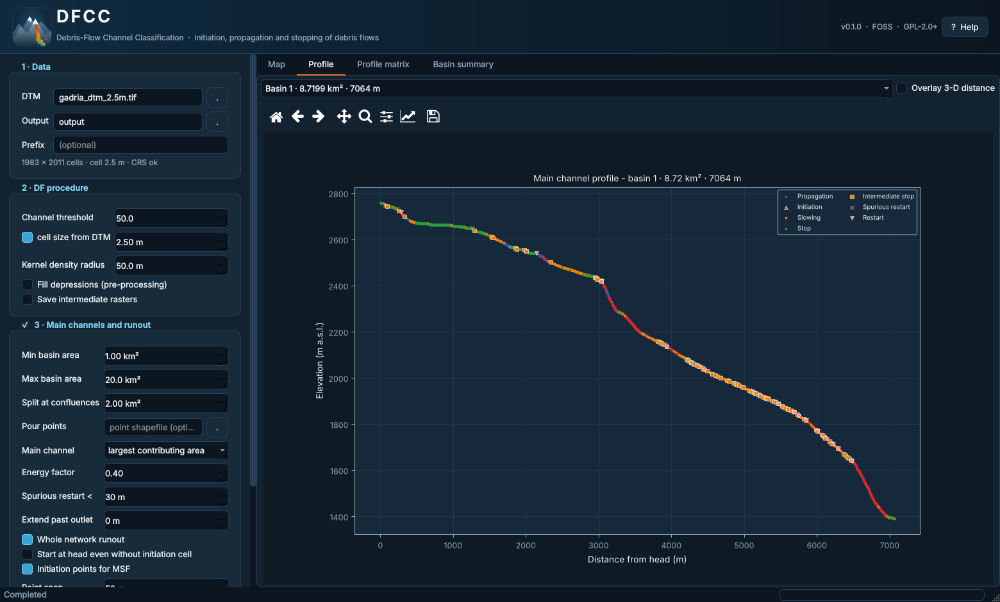<br><sub><b>Profile</b> — one basin, optional 3-D distance overlay.</sub></td>
<td width="50%">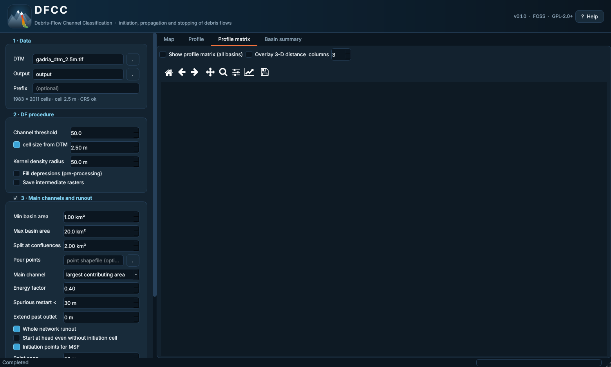<br><sub><b>Profile matrix</b> — all basins in a grid.</sub></td>
</tr>
<tr>
<td>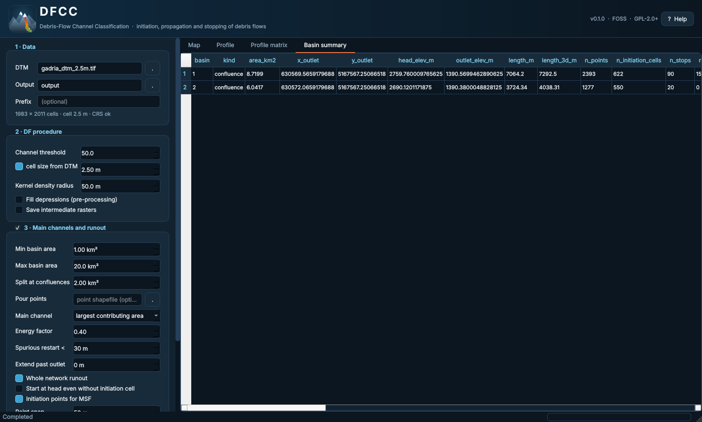<br><sub><b>Basin summary</b> — the content of <code>Runout_summary.csv</code>.</sub></td>
<td>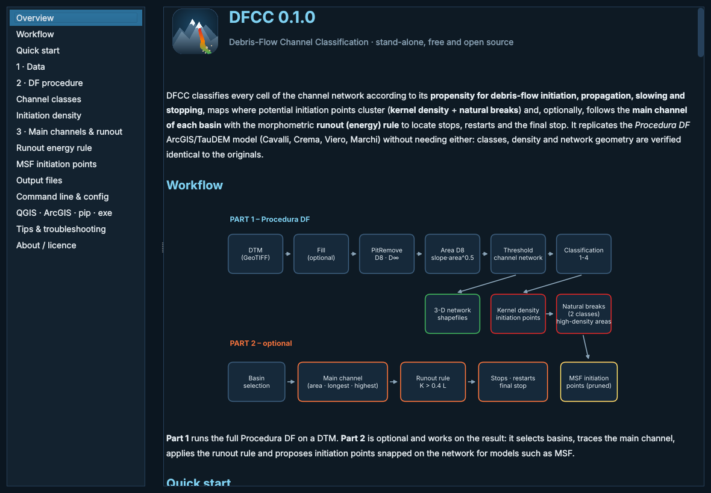<br><sub><b>Help</b> (button <i>? Help</i> or F1) — illustrated guide to data, parameters, colours, outputs and troubleshooting.</sub></td>
</tr>
<tr>
<td>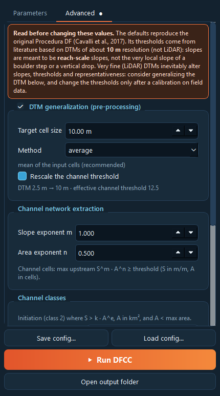<br><sub><b>Advanced</b> tab — resolution warning, DTM generalization, extraction exponents and class thresholds (shown with their angle), <i>Reset to defaults</i>. A ● on the tab means something differs from the standard procedure.</sub></td>
<td></td>
</tr>
</table>

Layer check-boxes on the map, basin labels, a detailed time-stamped **Console** (save/clear), JSON save/load of the whole configuration, and a dark theme.
Map legends are kept outside the map.

## Repository layout

```
DFCC/
├── src/dfcc/          Python package (core algorithms, pipeline, CLI, GUI, help)
├── examples/gadria/   test DTM, saved configuration, reference ArcGIS/TauDEM outputs
├── tests/             pytest suite (bit-level comparison with the originals)
├── docs/              METHOD.md, logo, figure/screenshot scripts and images
├── qgis_plugin/       QGIS Processing plugin
├── arcgis_toolbox/    ArcGIS Pro Python toolbox (.pyt)
├── packaging/         PyInstaller spec and build scripts for the stand-alone executable
├── old/               snapshot of the previous Procedura-DF repository (ArcGIS/TauDEM version)
└── .github/workflows/ CI tests and executable build
```

Build the Windows executable locally with `packaging\build_exe.bat` (or let the *release* workflow do it when a version tag is pushed).

### The `old/` folder

[`old/`](old) is an unmodified copy of the previous **Procedura-DF** repository (the ArcGIS/TauDEM implementation), kept for reference and as a backup.
The original repository remains available in the same GitHub account.

## Citation

If you use DFCC, please cite the method paper and this software:

* Cavalli, M., Crema, S., Trevisani, S., Marchi, L. (2017). GIS tools for preliminary debris-flow assessment at regional scale. *Journal of Mountain Science* 14(12), 2498-2510. <https://doi.org/10.1007/s11629-017-4573-y>
* Crema S., Cavalli M., Sarretta A. (2026). *DFCC — Debris-Flow Channel Classification*, version 0.4.0. <https://github.com/HydrogeomorphologyTools/DFCC> (see [`CITATION.cff`](CITATION.cff)).

The D8/D∞ routines derive from the native rewrites of *SedInConnect 3.2* ([HydrogeomorphologyTools](https://github.com/HydrogeomorphologyTools)), themselves ports of TauDEM (D. Tarboton).

## Authors and contact

**Stefano Crema** (main contact) · **Marco Cavalli** · **Alessandro Sarretta** — CNR GEO (Istituto di Geoscienze), 2026

* Contact: Stefano Crema — <stefano.crema@cnr.it>
* Bugs and feature requests: [GitHub Issues](../../issues)
* Other authors: marco.cavalli@cnr.it · alessandro.sarretta@cnr.it

## License

DFCC is free software released under the **GNU General Public License v2 or later** — see [LICENSE](LICENSE).
